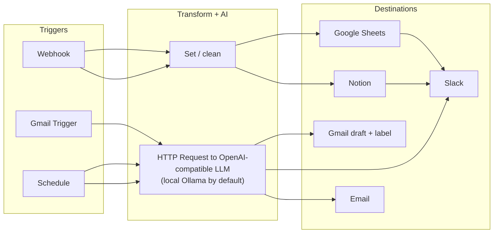
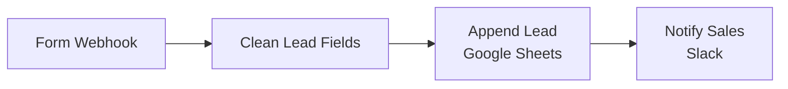
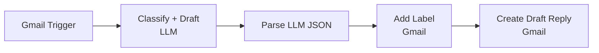
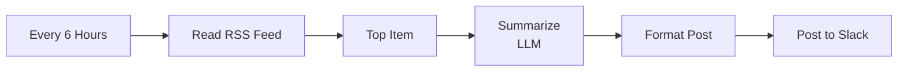
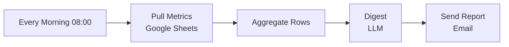
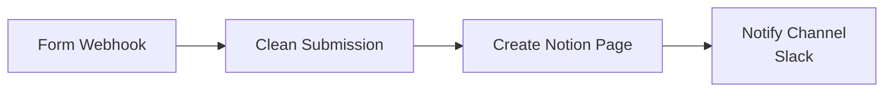

# n8n-automation-pack

Five polished, importable [n8n](https://n8n.io) workflows for the jobs small teams actually pay to automate: lead intake, email triage, content repurposing, daily reporting, and form capture. Each one is a hand-authored, structurally validated n8n export that drops straight into any instance via **Import from File**, with its LLM step pointed at a **local model (Ollama) by default** so nothing leaves your machine until you choose a hosted provider.

No screenshots of a demo instance here: these are the exact JSON files, the kind you hand a client. A tiny validator and a pytest gate prove every file is a legal n8n import before it ever reaches the GUI.

## The problem

Most automation gigs are variations on the same five shapes. Clients do not want a framework, they want the working flow they can see, edit, and own. This pack is those five shapes, built clean, documented, and runnable offline, so a build becomes "import, add your credentials, activate" instead of "start from a blank canvas".

## What is in the pack

| # | Workflow | What it does | Trigger | Key nodes | Credentials needed |
|---|----------|--------------|---------|-----------|--------------------|
| 1 | **lead-intake** | Capture a web form submission, clean the fields, log the lead to a Google Sheet, and alert sales in Slack | Webhook (POST) | Webhook, Set, Google Sheets, Slack | Google Sheets, Slack |
| 2 | **email-triage** | On each new email, a local LLM classifies it and drafts a reply, then the flow labels the message and saves the draft for a human to send | Gmail Trigger (poll) | Gmail Trigger, HTTP Request (LLM), Set, Gmail | Gmail, LLM endpoint |
| 3 | **rss-to-social** | Every few hours, read a feed, take the top item, have a local LLM write a short post, and drop it in Slack as a review queue | Schedule | Schedule, RSS Read, Limit, HTTP Request (LLM), Set, Slack | Slack, LLM endpoint |
| 4 | **daily-report** | Each morning, pull rows from a metrics sheet, have a local LLM write an executive digest, and email it | Schedule (cron) | Schedule, Google Sheets, Aggregate, HTTP Request (LLM), Email Send | Google Sheets, SMTP, LLM endpoint |
| 5 | **form-to-notion** | Capture a form submission, clean it, create a Notion database page, and notify a Slack channel | Webhook (POST) | Webhook, Set, Notion, Slack | Notion, Slack |

All AI-written output (draft replies, social posts, report digests) is labelled as AI-generated inside the output itself and routed to a human to review before anything is sent. These are drafting and triage aids, not auto-send bots.

## Architecture



Every LLM call is a single plain **HTTP Request** node hitting an OpenAI-compatible `/chat/completions` endpoint. The URL and model default to local Ollama and can be swapped to any provider by setting two environment variables (below), no node rewiring required.

## Per-workflow diagrams

**1. lead-intake**


**2. email-triage**


**3. rss-to-social**


**4. daily-report**


**5. form-to-notion**


## Quickstart (validate the pack)

You do not need n8n to verify these files are valid imports. The pytest gate checks every JSON offline.

1) `make install` (installs pytest)
2) `make test` (validates all 5 workflows)
3) `make validate` (same check with a readable per-file report)

```
$ make validate
OK   1-lead-intake.json
OK   2-email-triage.json
OK   3-rss-to-social.json
OK   4-daily-report.json
OK   5-form-to-notion.json

5/5 workflows valid
```

## Import into n8n

1) In n8n, open the workflows list and choose **Import from File** (top-right menu, "Import from File...").
2) Pick a file from `workflows/`, for example `workflows/1-lead-intake.json`.
3) The workflow opens on the canvas. Each node that needs a login shows a credential field: select or create the matching credential (see the list below).
4) Replace the placeholder values: Google Sheet IDs (`YOUR_GOOGLE_SHEET_ID`), the Slack channel ID (`C0000000000`), the Notion database ID (`YOUR_NOTION_DATABASE_ID`), the Gmail label ID (`Label_REPLACE_ME`), and the SMTP from/to addresses.
5) Click **Save**, then **Active** to switch the workflow on. For the two webhook workflows, copy the production webhook URL from the Webhook node and point your form at it.

## Credentials to add in n8n

Create these under **Credentials** in n8n before or during import. The exported files reference the credential *type*, so n8n prompts you to select your own account.

- **Google Sheets** (`Google Sheets OAuth2 API`) for workflows 1 and 4
- **Slack** (`Slack API`, bot token) for workflows 1, 3, and 5
- **Gmail** (`Gmail OAuth2`) for workflow 2
- **Notion** (`Notion API`, internal integration token) for workflow 5
- **SMTP** for workflow 4 (any mail provider)
- **LLM endpoint** for workflows 2, 3, and 4: no credential needed for local Ollama. For a hosted provider, add an `Authorization: Bearer <key>` header to the HTTP Request node.

## LLM configuration (local by default)

The LLM nodes read two environment variables with safe fallbacks, so they work out of the box against local Ollama and swap to any OpenAI-compatible provider with no edits to the nodes:

- `LLM_BASE_URL` default `http://127.0.0.1:11434/v1`
- `LLM_MODEL` default `qwen3:30b-a3b-instruct-2507-q4_K_M`

Set them in your n8n process environment (see `.env.example`). To point at OpenAI, Groq, Together, or similar, set `LLM_BASE_URL` to their `/v1` URL, set `LLM_MODEL`, and add the auth header on the HTTP Request node. n8n allows `$env` in expressions by default. If your instance sets `N8N_BLOCK_ENV_ACCESS_IN_NODE=true`, the nodes fall back to the hard-coded local defaults, so edit the HTTP node URL and model directly in that case.

## Sample input and output

**lead-intake** and **form-to-notion** are triggered by a form POST. Example request to the webhook:

```bash
curl -X POST https://<your-n8n-host>/webhook/lead-intake \
  -H "Content-Type: application/json" \
  -d '{"name":"Jordan Lee","email":"Jordan.Lee@ACME.com ","company":"Acme","message":"Need a quote"}'
```

After `Clean Lead Fields` the row written to the sheet is normalized:

```json
{"name":"Jordan Lee","email":"jordan.lee@acme.com","company":"Acme","message":"Need a quote","received_at":"2026-10-14T09:12:04.000Z"}
```

and Slack receives: `:inbox_tray: New lead *Jordan Lee* (jordan.lee@acme.com) from Acme`.

**daily-report** reads metric rows like `[{"date":"2026-10-13","signups":42,"revenue":1310,"churn":3}, ...]`, aggregates them into one item, and the LLM returns a plain-text digest such as:

```
Daily highlights:
- 42 new signups, up from the prior day
- Revenue 1,310, steady week over week
- Churn held at 3 accounts
Action: follow up on the 3 churned accounts this week.

-- AI-generated digest. A human must review before acting on it. --
```

## How it works

Each file is a standard n8n export: a top-level object with a `nodes` array and a `connections` map. Nodes are real `n8n-nodes-base.*` types (webhook, set, httpRequest, googleSheets, slack, gmailTrigger, gmail, scheduleTrigger, rssFeedRead, limit, aggregate, emailSend, notion). The LLM step is deliberately a generic HTTP Request to `/chat/completions` rather than a vendor node, which keeps the pack provider-agnostic and self-hosted-friendly. `validate.py` parses every file and asserts the structure n8n needs at import time: required node keys, unique non-empty node types, and connection endpoints that all resolve to real nodes. That validator is the test gate.

## Demo


See `DEMO.md` for the 60-second recording script. Screenshots of the imported workflows go in `docs/` (see `docs/README.md`).

## Tech stack

n8n (workflow engine), OpenAI-compatible chat API via HTTP (local Ollama by default), Python 3 standard library for the validator, pytest for the gate. No runtime dependencies beyond n8n itself.

## License

MIT, Copyright 2026 Al Amin Bashir Afara. See `LICENSE`.
